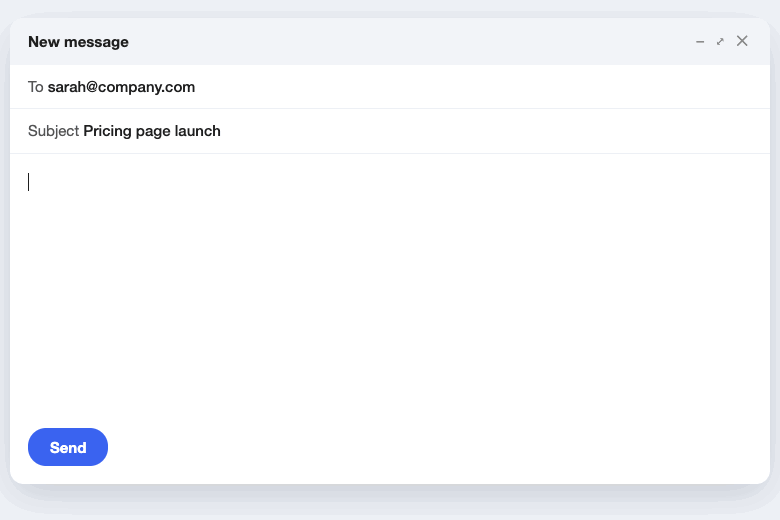
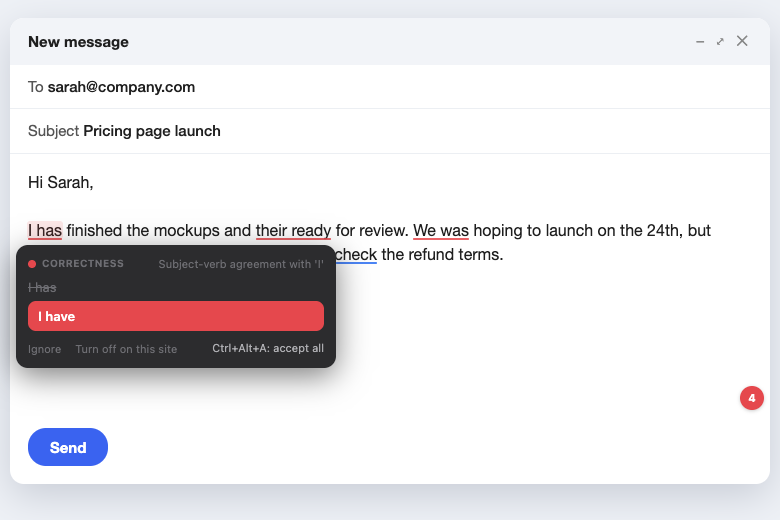
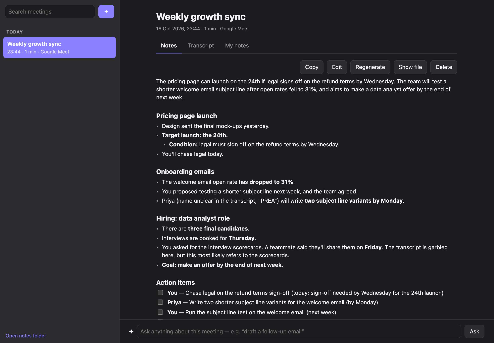
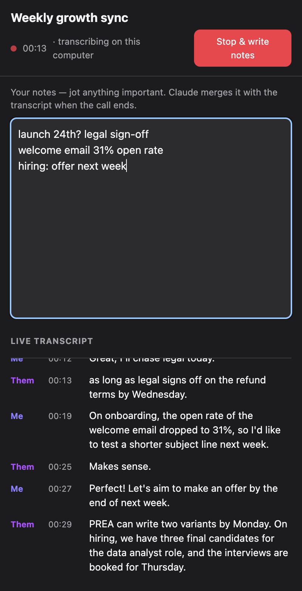
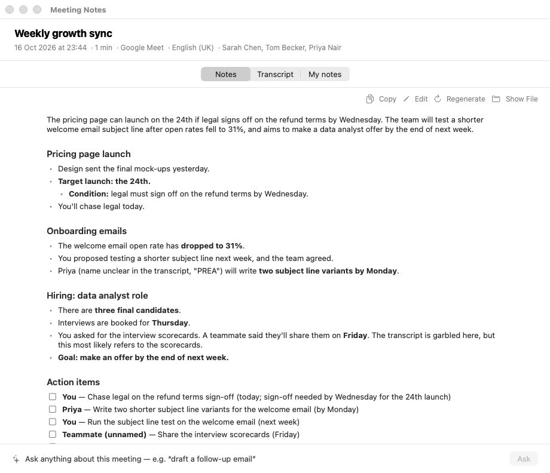
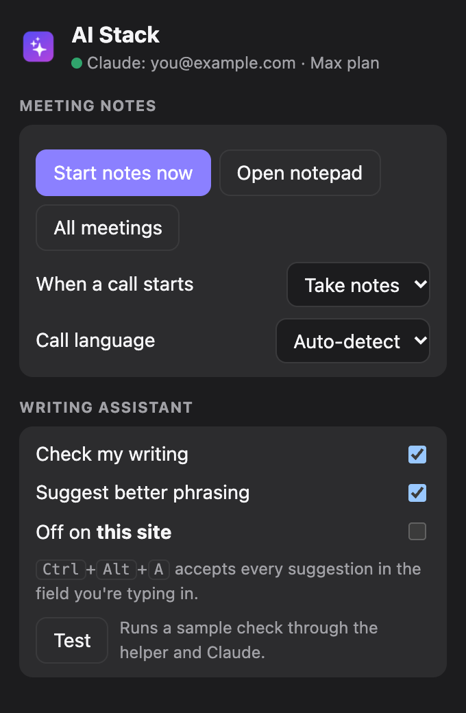
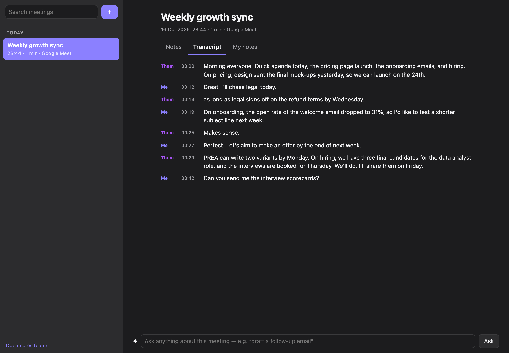
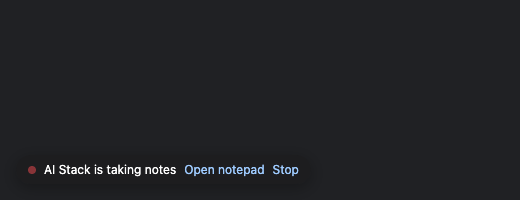
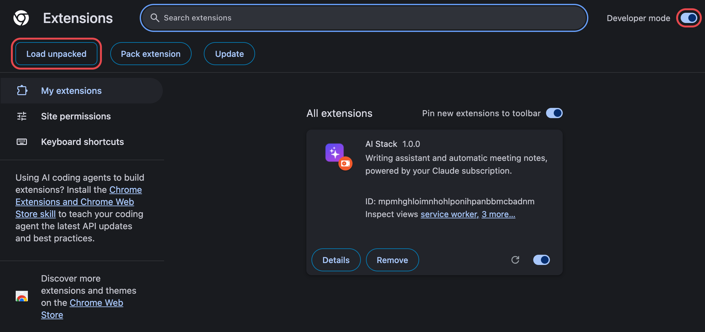
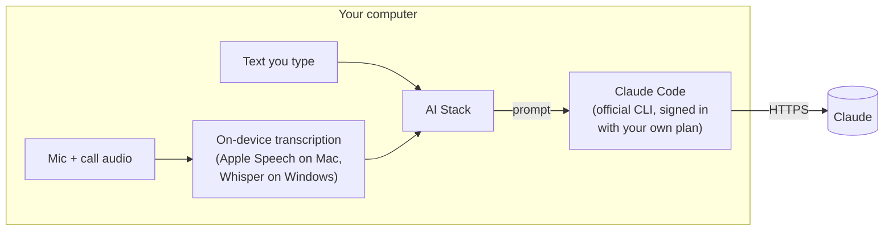

<div align="center">

# ✦ AI Stack

**An always-on writing assistant and AI meeting notetaker for macOS and Windows,<br>powered by the Claude plan you already pay for.**

No extra subscriptions · No API keys · Audio never leaves your computer

[Install on macOS](#-macos) · [Install on Windows](#-windows) · [How it works](#how-it-works) · [Privacy](#privacy)



</div>

---

## What it does

### ✍️ Writing assistant: catches mistakes as you type



- **Red underline** = spelling, grammar or punctuation error. **Blue underline** = clumsy or wordy phrasing, with a rewrite.
- **Hover** an underline to see the fix and click it, or press **Ctrl + Alt + A** (⌃⌥A on Mac) to accept everything at once.
- A small badge in the corner of the text box counts the suggestions and lists them all.
- Works in **every app on macOS** (Mail, Notes, Messages, Slack, Chrome…) and in **every text box in Chrome on Windows** (Gmail, LinkedIn, Notion, Slack…).
- Handles English, French and other languages, and keeps British or American spelling as you write it.

<br clear="right">

### 🎙️ Meeting notes: written for you after every call

- **Starts by itself** when you join a call in Google Meet, Microsoft Teams, Zoom, Slack, FaceTime, WhatsApp…, and stops when you hang up.
- **Transcribes both sides on your computer**: "Me" (your microphone) and "Them" (the call audio).
- **Jot your own notes** during the call; Claude organises the final notes around them.
- **A minute after the call**, you get clean notes: summary, topics, decisions and an **action-item checklist**.
- **Ask anything afterwards**: "what did we decide about pricing?", "draft a follow-up email".
- Every meeting is also saved as a Markdown file in `Documents/Meeting Notes`.

| Notes after the call | Live notepad during the call |
|:---:|:---:|
|  |  |

<details>
<summary><b>More screenshots</b></summary>

| macOS notes window | Chrome toolbar popup | Transcript |
|:---:|:---:|:---:|
|  |  |  |

While a call is being recorded, a small pill sits in the corner of the call page:



</details>

---

## Requirements

- A **Claude Pro or Max** subscription
- **Claude Code**, Anthropic's command-line tool (the installer sets it up for you)
- **macOS 26 (Tahoe) or later** on Apple silicon or Intel, **or** **Windows 10/11** with **Google Chrome**

---

## Install

### 🍎 macOS

Open **Terminal** and paste:

```bash
curl -fsSL https://raw.githubusercontent.com/gaspardol/ai-stack/main/install.sh | bash
```

The script installs **AI Stack** in Applications, installs Claude Code if needed, signs you in to Claude, and starts the app. AI Stack then lives in the menu bar (✦) and opens a setup window that walks you through the permissions:

| Permission | Why |
|---|---|
| **Accessibility** | Read the text field you're typing in and draw the underlines |
| **Microphone** | Transcribe your side of calls |
| **System Audio Recording** | Transcribe the other people on the call |
| Calendar *(optional)* | Name meetings after your calendar events and list attendees |
| Notifications | "Taking notes…" / "Notes ready" |

It starts at login and restarts itself if it ever crashes. To quit, use ✦ → Quit.

<details>
<summary>Manual install (without Terminal)</summary>

1. Download **AI-Stack-macOS.zip** from the [latest release](https://github.com/gaspardol/ai-stack/releases/latest) and drag **AI Stack** into Applications.
2. Open it. If macOS says it can't verify the developer, go to **System Settings → Privacy & Security** and click **Open Anyway**.
3. Install Claude Code (`curl -fsSL https://claude.ai/install.sh | bash`) and run `claude` once to log in.
</details>

### 🪟 Windows

Open **PowerShell** (Start menu → "PowerShell") and paste:

```powershell
irm https://raw.githubusercontent.com/gaspardol/ai-stack/main/install.ps1 | iex
```

The installer copies AI Stack to your computer, installs Claude Code and signs you in to Claude, then downloads the speech model (~180 MB). Finally it opens Chrome's Extensions page, where you do the one manual step:

1. Turn on **Developer mode** (top right).
2. Click **Load unpacked** and paste the folder path the installer copied to your clipboard (`%LOCALAPPDATA%\AIStack\extension`).
3. Pin the ✦ AI Stack icon (puzzle-piece menu → pin).



Click the ✦ icon → **Test** to check that everything is connected.

<details>
<summary>Manual install (zip)</summary>

1. Download **AI-Stack-Windows.zip** from the [latest release](https://github.com/gaspardol/ai-stack/releases/latest).
2. Right-click it → **Properties** → tick **Unblock** → OK, then **Extract All**.
3. Double-click **Install AI Stack.cmd**. If you see "Windows protected your PC", click **More info → Run anyway**.
</details>

**Updating** (either platform): run the same install command again. On Windows, then click ↻ on the AI Stack card in `chrome://extensions`.

---

## Using it

| | macOS | Windows (Chrome) |
|---|---|---|
| See a suggestion | Hover the underline | Hover the underline |
| Accept everything | **⌃⌥A** | **Ctrl + Alt + A** |
| All suggestions in a list | Click the badge in the text box | Click the badge in the text box |
| Turn off for one app/site | ✦ menu → Turn Off in *App* | Card → "Turn off on this site" |
| Start notes manually | ✦ menu → Start Notes Now | ✦ icon → Start notes now |
| Your meetings | ✦ menu → Open Meeting Notes | ✦ icon → All meetings |
| Call language | ✦ menu → Call Language | ✦ icon → Call language (auto-detect) |

---

## How it works



- AI Stack never sees your Claude password or tokens. It runs the **official, unmodified `claude` program** that you signed in to through Anthropic's own login, and the usage counts against **your own plan**.
- Grammar checks use **Claude Haiku** (fast). Meeting notes use **Claude Opus**, and questions about a meeting use **Sonnet**. A pre-started Claude Code process keeps checks around one to two seconds.
- Only paragraphs you changed are re-checked, so normal typing stays light on your plan.

| Platform | Pieces |
|---|---|
| macOS | Native SwiftUI menu-bar app: Accessibility API for text and underlines, Core Audio taps for call audio, SpeechAnalyzer (macOS 26) for transcription |
| Windows | Chrome extension (underlines, call detection, notepad, library) + `AIStackHelper.exe` (.NET 10): Claude Code bridge, WASAPI audio capture, Whisper transcription |

---

## Privacy

- **Audio** is transcribed on your computer and is never uploaded or saved.
- **Text you type** and **meeting transcripts** are sent to Claude only through your own Claude Code, under [Anthropic's privacy policy](https://www.anthropic.com/legal/privacy).
- **Meetings** are stored on your computer only:
  - macOS: `~/Library/Application Support/AIStack`
  - Windows: `%LOCALAPPDATA%\AIStack`
  - Markdown copies: `Documents/Meeting Notes`
- **No analytics, no accounts, no servers.** Nothing is sent to the author of AI Stack.
- **Recording calls:** many places require you to tell the other participants. Switch call detection to "Ask me" or "Do nothing" if you prefer to start notes yourself.

## Claude plans and Anthropic's terms

AI Stack is an independent open-source project. It is **not affiliated with or endorsed by Anthropic**, Grammarly or Granola. It works by running Claude Code on your computer, so [Anthropic's terms](https://www.anthropic.com/legal/consumer-terms) and the [Claude Code legal and compliance page](https://code.claude.com/docs/en/legal-and-compliance) apply to your use. Read them and decide for yourself. If Anthropic changes how Claude Code may be used, AI Stack may stop working.

---

## Troubleshooting

| Problem | Fix |
|---|---|
| No underlines on macOS | ✦ menu: if it says *Grant Accessibility Permission*, click it and enable AI Stack in System Settings. |
| No underlines on Windows | ✦ icon → **Test**. "Helper not installed": run the installer again. A Claude error: open a terminal and run `claude` to log in. |
| Badge shows **!** | Hover it to read the Claude error (not logged in, usage limit reached…). |
| A call wasn't detected | Start notes manually from the ✦ menu or icon, and check the call-detection setting. |
| Notes say "not enough speech" | macOS: check *Call audio* and *Microphone* in ✦ → Setup & Permissions. |

Logs: `~/Library/Logs/AIStack/aistack.log` (macOS) · `%LOCALAPPDATA%\AIStack\logs\helper.log` (Windows)

**Uninstall:**
- **macOS:** ✦ → Quit, delete *AI Stack* from Applications, and remove it from System Settings → General → Login Items.
- **Windows:** run *Uninstall AI Stack.cmd* from the zip, remove the extension in `chrome://extensions`, and delete `%LOCALAPPDATA%\AIStack`.

---

## Build from source

```bash
./scripts/build.sh          # macOS app → /Applications (needs Xcode 26)
./windows/package.sh        # Windows zip (needs the .NET 10 SDK; builds fine on a Mac)
./scripts/release.sh        # both release downloads → dist/
```

```
Sources/AIStack/        macOS app (Swift / SwiftUI)
  Core/                 Claude Code bridge, settings, logging
  Writing/              Accessibility text tracking, grammar engine, underline overlay
  Notes/                call detection, audio capture, transcription, notes
windows/extension/      Chrome extension (Manifest V3)
windows/helper/         AIStackHelper.exe (.NET 10, native messaging host)
```

Self-tests: `AIStack --selftest grammar|notes|transcribe <file>` (macOS) and `AIStackHelper --selftest claude|meeting <me.wav> <them.wav>`.

## License

[MIT](LICENSE)
